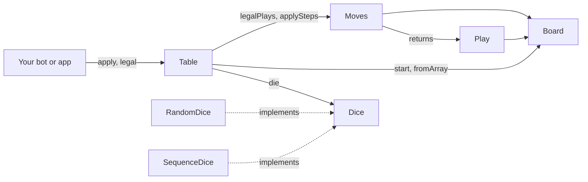
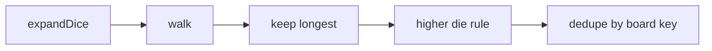
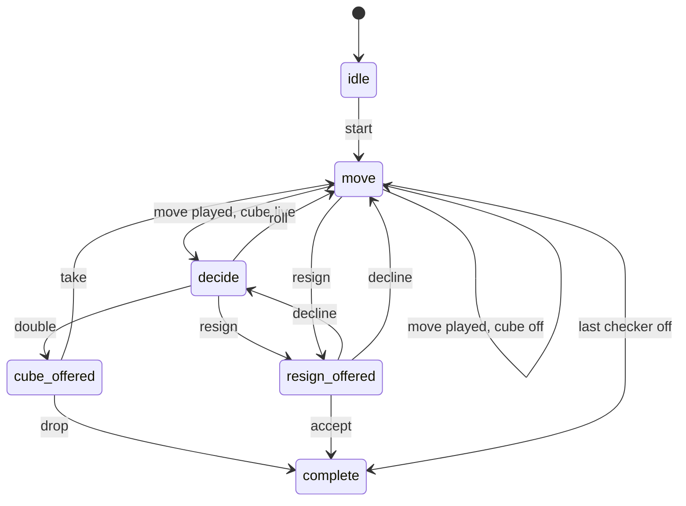

# backgammon-network/engine

A framework-free PHP backgammon engine for writing and testing bots. As far as we could find, there was no PHP backgammon library on Packagist or GitHub when this was published. It's the engine behind backgammon.network.

It has seven classes and no runtime dependencies. `Table` and `Moves` are static functions. `Board` and `Play` are immutable values. Nothing touches files, the network or a database. Game state is a plain array that round trips through JSON, and the only source of randomness is a `Dice` object you pass in.

## Install

```
composer require backgammon-network/engine
```

Needs PHP 8.3 or newer.

## Quickstart

A bot is a function. It gets the state, its seat and the legal options, and returns an action. This one plays the first legal move.

```php
use BackgammonNetwork\Engine\Dice\RandomDice;
use BackgammonNetwork\Engine\Table;

require __DIR__.'/vendor/autoload.php';

$bot = fn (array $state, int $seat, array $legal): array => $state['phase'] === 'move'
    ? ['type' => 'move', 'steps' => $legal['plays'][0] ?? []]
    : ['type' => 'roll'];

$dice = new RandomDice;
$state = Table::start(Table::create(['cube' => false, 'length' => 1, 'crawford' => false], ['Ann', 'Bob']), $dice);

while (Table::live($state)) {
    $seat = $state['toAct'];
    $state = Table::apply($state, $seat, $bot($state, $seat, Table::legal($state, $seat)), $dice);
}

echo "{$state['names'][$state['result']['winner']]} wins by {$state['result']['kind']}\n";
```

The same code lives in `examples/play-a-game.php`. Replace the `$bot` closure with your own.

## How it fits together



Dependencies run one way. Your code enters through `Table`. A bot can also read `Board` and `Moves` directly to score plays.

| Class | Role |
| --- | --- |
| `Board` | A position. Pip counts, the start layout, a canonical key. |
| `Moves` | Legal play generation, plus `expandDice` and `applySteps`. |
| `Play` | One legal play and the board it leads to. |
| `Table` | One game as a state machine. Rolls, cube, resignation, result. |
| `Dice\Dice` | Interface with one method, `die()`. |
| `Dice\RandomDice` | Fair dice from `random_int`. |
| `Dice\SequenceDice` | Fixed dice for tests. Throws when it runs out. |

## The board

A position is one signed integer per point. Seat 0 is positive and seat 1 is negative. Each seat counts pips from its own side, so one array index has two names:

- Seat 0 pip `p` is index `p - 1`.
- Seat 1 pip `p` is index `24 - p`.

The opening position as `Board::start()` builds it:

| Pip | 24 | 13 | 8 | 6 |
| --- | --- | --- | --- | --- |
| Seat 0 index and count | 23, +2 | 12, +5 | 7, +3 | 5, +5 |
| Seat 1 index and count | 0, -2 | 11, -5 | 16, -3 | 18, -5 |

The bar is pip 25 for both seats and lives in `bar[seat]`. Checkers borne off count in `off[seat]`, and 15 ends the game. `Board::key()` turns points, bar and off into one string, and that's how positions are compared. `Board::positionKind($loser)` reads single, gammon or backgammon straight off the board.

## Move generation



`Moves::legalPlays($board, $seat, $dice)` runs five stages:

1. **expandDice** turns a roll into the dice to play. Doubles become four dice.
2. **walk** is a depth-first search. For each distinct die left, it tries every source pip from the top down and recurses on the rest. The bar is pip 25, so a checker on the bar is tried first, and no other checker can move while one waits there. For doubles, the last source pip becomes the next ceiling, so the same four moves can't be reached in different orders.
3. **keep longest** keeps the sequences that use the most dice. A sequence that bears off the last checker counts as using all of them.
4. **higher die** applies when only one die of a non-double roll can be played. If a sequence plays the larger die, sequences playing the smaller one are dropped.
5. **dedupe** keeps the first sequence found per board key.

Traversal order decides which step list you get for a position, so it's part of the contract. The legal-plays fixture in `tests/fixtures` pins it.

## The table



`Table::forfeit($state, $seat)` also ends the game from any live phase.

### State

Seats are `0` and `1`. Every function returns a new state and leaves the old one alone. Illegal actions throw a `DomainException`.

`Table::create($config, $names)` makes an idle table. `Table::start($state, $dice)` rolls for the opening, rerolls ties, and begins a game.

Useful keys on the state:

- `phase`: where the game is
- `toAct`: the seat that must act, or `null`
- `dice`: the dice on the table
- `board`: `points`, `bar` and `off`
- `cube`: `value` and `owner`
- `result`: `winner`, `kind`, `how` and `points` once the game is complete
- `log`: a list of entries, each with a `text` line

Phases:

- `idle`: no game yet
- `decide`: the player to act may double or roll
- `move`: dice are rolled and a move is due
- `cube_offered`: a double waits for a take or a drop
- `resign_offered`: a resignation waits for an accept or a decline
- `complete`: the game is over

### Actions

`Table::apply($state, $seat, $action, $dice)` takes an action array with a `type`.

| type | when | fields |
| --- | --- | --- |
| `roll` | `decide` | none |
| `double` | `decide`, cube on | none |
| `take` | `cube_offered` | none |
| `drop` | `cube_offered` | none |
| `move` | `move` | `steps` |
| `resign` | `decide` or `move` | `kind`: `single`, `gammon` or `backgammon` |
| `accept` | `resign_offered` | none |
| `decline` | `resign_offered` | none |

A move's `steps` is a list of `['from' => ..., 'to' => ...]`. Each end is a point index from 0 to 23, `'bar'` for `from`, or `'off'` for `to`.

`Table::legal($state, $seat)` returns `canRoll`, `canDouble`, `canTake`, `canDrop`, `canResign`, `canAccept`, `canDecline` and `plays`. Each entry in `plays` is a list of steps you can pass straight to a `move` action. An empty list means no move is possible.

### How a turn runs

- After a move, the other seat gets the dice. If that seat can double, the phase is `decide` and the table waits. Otherwise it rolls for them and goes straight to `move`.
- A roll with no legal move logs a pass and starts the next turn. After two passes in a row the table stops auto-passing and stays in `move`, so a stuck position can't loop.
- `apply` validates a move by playing your steps on the board, then looking for a legal play that reaches the same board key. Any step order that lands on a legal position is accepted, and the stored board is the engine's own.
- `Dice::die()` is called when the table opens and when a roll is made. Nothing else reads it, so a `SequenceDice` replays a game exactly.

### Config

`cube` turns doubling on or off. `length` and `crawford` are kept in the config for match logic, but `Table` doesn't read them. It plays one game and has no match score. It does have a `crawfordGame` flag in the state that blocks doubling, and a match layer is expected to set it.

## Testing a bot

`SequenceDice` hands out the dice you give it, in order. It throws when it runs out.

```php
use BackgammonNetwork\Engine\Dice\SequenceDice;

$dice = new SequenceDice([6, 1, 3, 1]);
$table = Table::create(['cube' => false, 'length' => 1, 'crawford' => false], ['Ann', 'Bob']);
$state = Table::start($table, $dice);
```

The first two dice are the opening roll. Here seat 0 rolls 6, seat 1 rolls 1, so seat 0 opens and plays 6-1. The next two dice go to the next roll.

Run the suite with `composer test`.

## Limits

- `Table::legal()` regenerates plays on every call, and `apply` does it again. There's no cache, and the cost hasn't been measured.
- State shapes are described in docblock types for static analysis. Nothing enforces them at runtime beyond the checks in `apply`.
- There's no match scoring, no clock and no notation parser.

## Contributing

See [CONTRIBUTING.md](CONTRIBUTING.md).

## License

MIT
